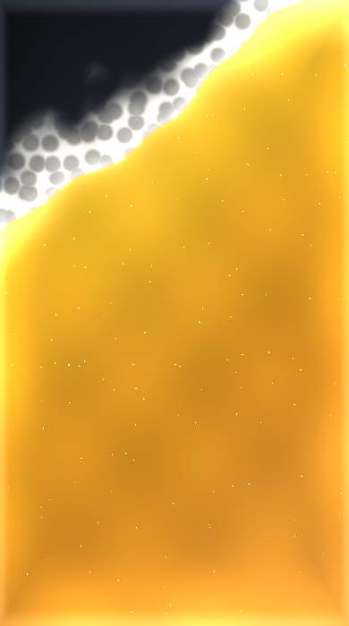
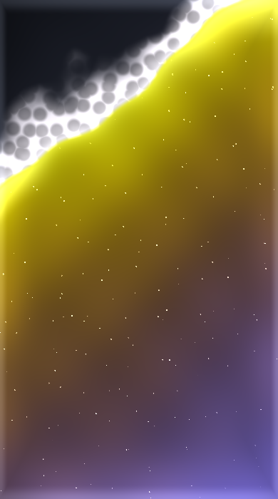

# aibeer

An iBeer-style beer-drinking trick for the iPhone: the screen fills with beer,
and the gyroscope makes the liquid stay level with the real world as you tilt
the phone. Swipe left or right to change your drink. Four modes: Pale Lager,
Brown Ale, Black Stout, and a just-for-fun Rainbow.

Native iOS app: **Swift + SwiftUI + SpriteKit (`SKShader`) + CoreMotion**, with
the liquid rendered by a single GLSL ES fragment shader. The simulation logic
lives in a framework-free Swift package (`BeerCore`) that fully builds and unit
tests on Linux/WSL2, and a WebGL preview harness renders the exact same shader
and style presets in a browser — so everything short of the final Xcode build
is verified before touching a Mac.




## Repo layout

```
aibeer/
├── project.yml              # XcodeGen spec (iOS 16+, portrait, BeerCore package dep)
├── setup.sh                 # rootless Linux/WSL2 tooling installer (Swift, glslang, …)
├── .swift-format            # formatter/linter config
├── BeerCore/                # SwiftPM package — pure Swift, no Apple frameworks
│   ├── Sources/BeerCore/    #   GravityProjector, GravityFilter, WobbleModel,
│   │                        #   FillController, BeerStyle
│   ├── Sources/beerctl/     #   CLI: dumps style presets as JSON for the preview
│   └── Tests/BeerCoreTests/ #   XCTest suite — runs on Linux
├── shaders/beer-liquid.fsh  # THE liquid shader — single source of truth
├── preview/                 # WebGL dev harness (same shader + same presets)
│   ├── template.html        #   harness source (placeholders for shader/styles)
│   ├── styles.json          #   generated by `beerctl dump-styles`
│   ├── index.html           #   generated by tools/embed.mjs — open in a browser
│   └── screenshots/         #   generated by tools/screenshot.sh
├── tools/                   # gate.sh, validate-shader.sh, embed.mjs, screenshot.sh
└── aibeer/                  # iOS app sources
    ├── App/                 #   SwiftUI entry + full-screen SpriteView + controls
    ├── Scene/BeerScene.swift#   wires BeerCore → shader uniforms every frame
    ├── Motion/              #   CoreMotion wrapper + simulator pan fallback
    └── Assets.xcassets/
```

## How it works

- **`BeerCore`** (pure Swift, Linux-testable):
  - `GravityProjector` — device-frame gravity vector → screen-space down
    direction, correct for all four orientations (unit-tested).
  - `GravityFilter` — exponential low-pass over the tilt direction (no jitter,
    no angle wrap issues); holds the last direction when the phone lies flat.
  - `SloshModel` — the liquid surface as a damped harmonic oscillator (the
    classic SDOF sloshing analog from tank-dynamics literature): the surface
    angle chases the container's level direction on a spring (ω₀ ≈ 1.4 Hz,
    ζ ≈ 0.15) so it *lags* fast tilts, *overshoots*, and visibly sloshes before
    settling. Outputs a `u_tilt` surface direction plus wave energy.
  - `WobbleModel` — rotation-rate energy adds extra surface chop.
  - `FillController` — eases fill level toward target; draining glugs faster
    than filling pours.
  - `BeerStyle` — one struct per beer mode: body gradient colors, glow, foam,
    bubble density/size/speed, rainbow flag.
- **`shaders/beer-liquid.fsh`** — one fragment shader consumed by both hosts:
  `SKShader` on iOS (SpriteKit injects the prolog) and WebGL1 in the preview
  (precision line prepended). Techniques (from researching current real-time
  liquid-shading best practice):
  - **Beer-Lambert extinction + in-scattering**: per-channel
    `transmit = exp(-σ·depth)` with σ derived from the style's deep color
    (naturally absorbs blue hardest, like real beer), plus
    `light·transmit + glow·(1−transmit)` ambient in-scatter — replaces naive
    linear color gradients.
  - **Surface geometry from the slosh oscillator**: the drawn surface is
    perpendicular to `u_tilt` (lagging/oscillating), *not* to true gravity —
    the liquid piles up when the glass turns faster than it can slosh.
  - **Bubbles rise along true down** (`-u_gravity`), independent of the
    sloshing surface: depth-sheared pseudo-acceleration, pressure-drop growth,
    rise-aligned highlights, fade-in from the deep.
  - **Worley cellular foam** with darker rims; sloshing whips up extra foam.
  - **Meniscus** crease at the liquid–glass contact, wet film above the
    surface at the walls, fresnel-style wall brightening, crest-steepened
    drifting waves.
  - **Seamless time on mediump GPUs**: `u_clock` wraps at 60 s and every wave/
    bubble/foam frequency is an integer number of cycles per minute — no
    ever-growing `sin()` arguments, no visible wrap.
- **`MotionService`** — `CMMotionManager` at 60 Hz (no permission prompt needed
  for gyro/accelerometer). When sensors are unavailable (iOS Simulator), a
  pan-gesture fallback fakes the tilt so everything is still testable.

## Linux / WSL2 verification gates

One-time tooling install (rootless, no sudo):

```sh
./setup.sh
```

Then, any time:

```sh
tools/gate.sh            # swift test · beerctl dump · glslangValidator ·
                         # swiftc -parse (iOS files) · YAML check · swift-format
tools/screenshot.sh      # regenerate preview/screenshots via headless Chromium
```

`gate.sh` must pass before any commit; it re-generates `preview/styles.json`
and `preview/index.html` so the shader and presets stay in sync everywhere.

## Browser preview (no Mac needed)

Open `preview/index.html` in any browser (double-click works — everything is
inlined). Drag to tilt, swipe left / right to change drink, arrow keys tilt,
or use URL params:

```
preview/index.html?style=blackStout&fill=0.72&deg=35&wobble=0.035&freeze=1&clean=1
```

Params: `style` (lager|brownAle|blackStout|rainbow), `fill` (0–1), `deg`
(tilt direction degrees), `wobble` + `freeze=1` (pin wave amplitude), `kick=1`
(start the surface off-level to watch it slosh). The UI has no text at all —
drag tilts, a horizontal flick changes the drink.

## Getting it on your iPhone (no Mac needed)

The PWA under `app/` is the full experience — same shader, same BeerCore
physics ports, real gyroscope — installable from Safari in one minute.

### Deploy (once)

```sh
git init && git add -A && git commit -m "aiBeer"
# create a GitHub repo, then:
git remote add origin git@github.com:YOU/aibeer.git && git push -u origin main
```

On GitHub: **Settings → Pages → Source: GitHub Actions**. The included
workflow (`.github/workflows/deploy-pages.yml`) then does a full CI build on
every push to `main` — **from source, no generated artifacts in the repo**:

1. Swift on the runner: `swift test` (BeerCore) → `beerctl dump-styles`
2. `glslangValidator` shader gate
3. Playwright/Chromium: generate the icon set
4. `tools/embed.mjs`: inline shader + styles + runtime into `app/index.html`
5. Deploy `app/` to Pages at `https://YOU.github.io/aibeer/`

Because the generated artifacts are gitignored, a fresh clone needs one local
bootstrap before opening the preview or app:

```sh
./setup.sh      # once: Swift toolchain, glslang, swift-format, Chromium
tools/gate.sh   # every session: tests + regenerates styles/preview/app
```

### Install on the iPhone

1. Open the HTTPS URL in **Safari** (must be HTTPS — the gyroscope
   permission API requires a secure context).
2. Tap **Enable tilt & pour** → grant the motion permission.
3. **Share → Add to Home Screen.** Launch from the icon: full-screen,
   no browser chrome, works offline (service worker).

No Mac, no Apple Developer account, no App Store — and updating the app is
`git push`.

### Quick test without deploying

Serve over a public HTTPS tunnel from WSL2:

```sh
python3 -m http.server 8080 -d app &
npx --yes localtunnel --port 8080   # open the https URL on your phone
```

(Gyroscope data never leaves the phone; the tunnel is just static file
serving.)

### PWA technical notes

- Gyroscope: `deviceorientation` (β/γ) → screen-space world-down, with the
  same orientation-angle rotations as `GravityProjector` (portrait/landscape/
  upside-down). iOS 13+ requires `DeviceOrientationEvent.requestPermission()`
  from a user gesture — handled by the first-tap overlay.
- No sensors / permission denied → automatic fallback to drag-to-tilt.
- Offline: service worker (`app/sw.js`) caches the whole app shell;
  the app itself is one self-contained HTML file.
- Icons are generated from `tools/icon.html` via `tools/gen-icons.sh`
  (includes a maskable variant for Android).

## Native app without Xcode (CI builds the .ipa)

No Mac with Xcode? GitHub's macOS runners build the native app for you.
Pushing to `main` (or a manual **workflow_dispatch**) runs
`.github/workflows/build-native-ipa.yml`, which archives the app unsigned and
publishes it as the **`aibeer-unsigned-ipa`** artifact on the run page.

Sign and install it from any Windows/Linux/macOS PC with
[Sideloadly](https://sideloadly.io) (free, uses a regular Apple ID):

1. Download `aibeer-unsigned-ipa` from the workflow run's **Artifacts**
   section and unzip
2. Install [Sideloadly](https://sideloadly.io) + Apple's iTunes/iCloud
   (from apple.com, for the USB drivers)
3. Plug in the iPhone (trust the computer), drag the `.ipa` into Sideloadly,
   enter your Apple ID (with 2FA use an
   [app-specific password](https://appleid.apple.com)), **Start**
4. On the iPhone: **Settings → General → VPN & Device Management** → trust
   your Apple ID → launch aiBeer — native, real gyro, no status bar

Free-Apple-ID rules apply: the build expires after **7 days** (re-sideload to
renew), max 3 side-loaded apps per device. [AltStore](https://altstore.io) is
an alternative that can re-sign wirelessly.

## Building the iOS app (on a Mac)

### Free: run it on your own iPhone (no Apple Developer Program)

Any Apple ID works — no $99 enrollment. Requirements: Xcode (free, Mac App
Store), your iPhone, a USB cable.

```sh
brew install xcodegen
cd aibeer
xcodegen generate        # creates aibeer.xcodeproj
open aibeer.xcodeproj
```

1. Target **aibeer** → **Signing & Capabilities** → **Team**: pick your
   Apple ID (a "Personal Team" — Xcode creates it automatically)
2. Connect the iPhone by cable, select it in the device dropdown, **Cmd+R**
3. First run only: on the iPhone, **Settings → General → VPN & Device
   Management** → tap your Apple ID → **Trust**

This build hides the status bar and home indicator entirely (the PWA can't do
that on iOS). Catch: free-provisioned apps **expire after 7 days** — plug in
and Cmd+R again to renew (30 s). Max 3 side-loaded apps per device per week;
no TestFlight/App Store.

### Paid: TestFlight / App Store

With the $99/yr Apple Developer Program the same project uploads to
TestFlight or the App Store (signing on CI is also possible).

### Simulator & device notes

- **Simulator:** works fully via the pan-gesture fallback (drag = tilt). The
  simulator has no gyro.
- **Real iPhone:** tilt the phone — the beer surface stays level with the
  world. (See the free-provisioning steps above for signing.)
- If your Xcode version wants `GLKVector2` instead of `SIMD2<Float>` in
  `SKUniform(name:vectorFloat2:)` calls, adjust those two call sites in
  `BeerScene.makeShader()` — it's a one-line-per-uniform mechanical change.

### App Store notes

- Naming: "iBeer" is an existing trademark (Hottrix famously sued Coors over
  this exact genre of knockoff). Pick a distinct store name; the repo name is
  fine for personal use.

## Deferred (v1 scope cut, by design)

Tilt-to-drink auto-drain, gulp/burp sound design, shake-to-refill, foam
residue rings, finger-through-foam touch, more drink families. The FillController
and style system are built to absorb these without restructuring.
